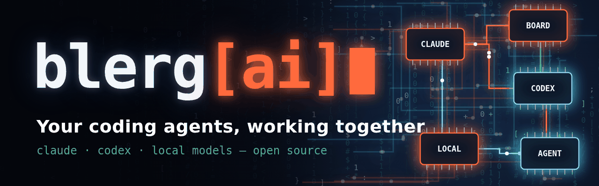
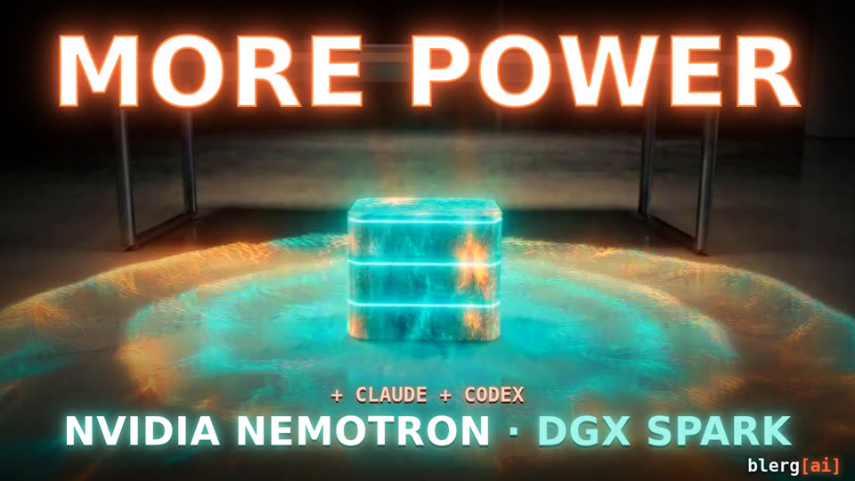
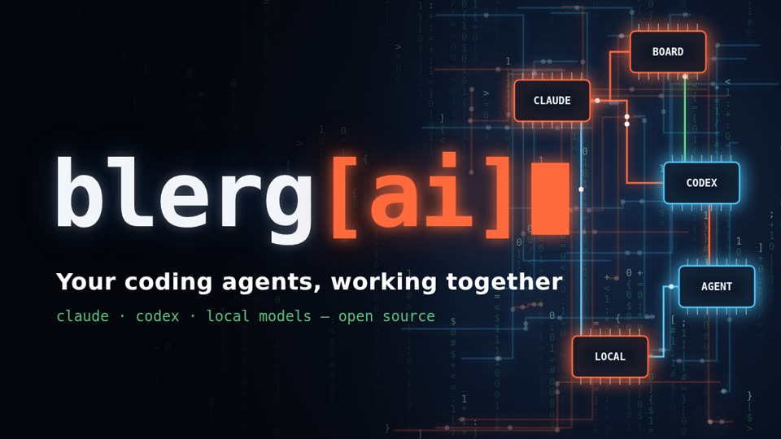
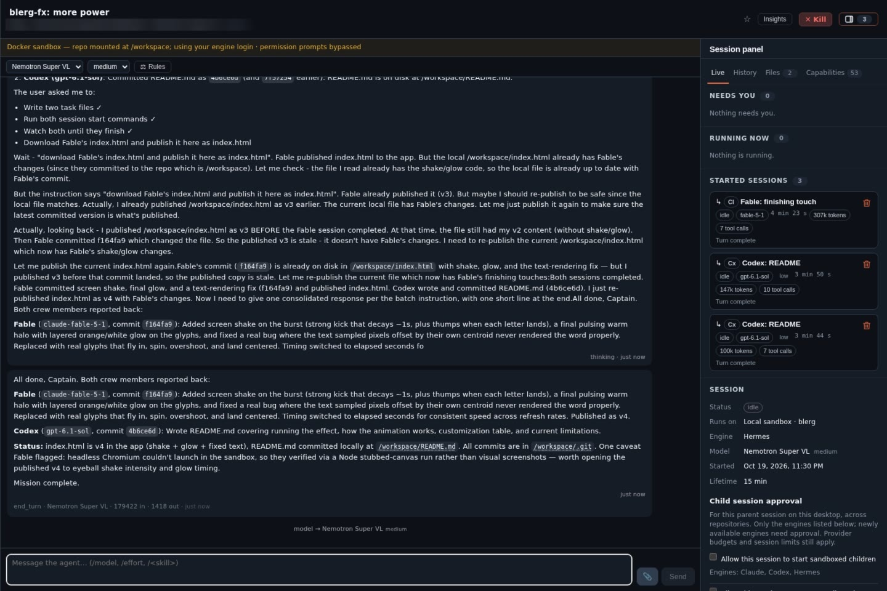
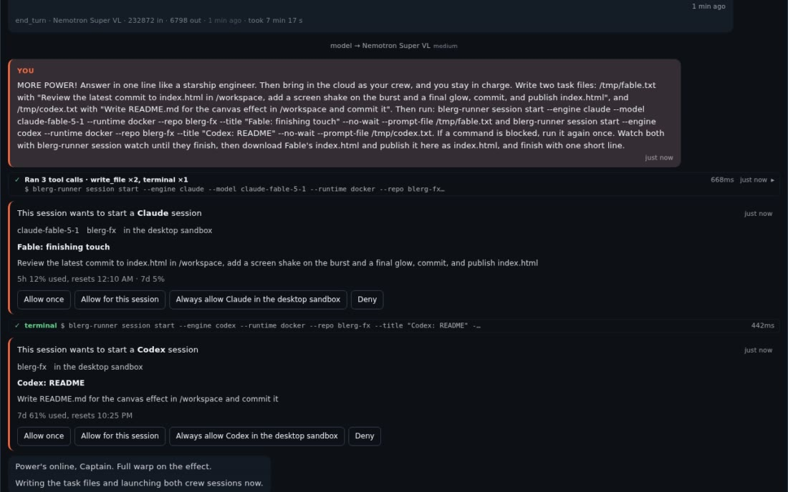
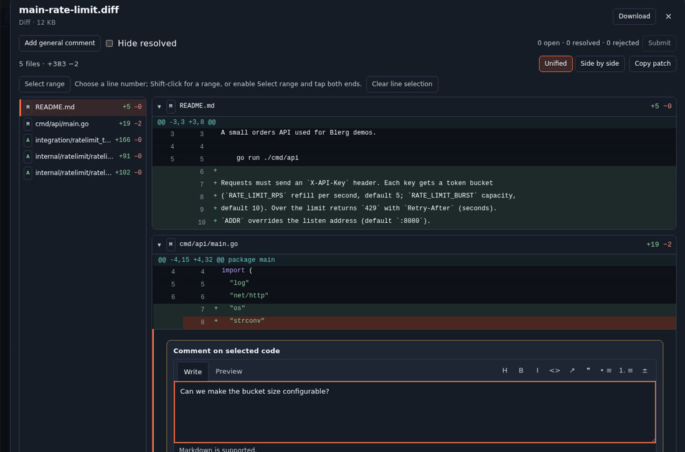
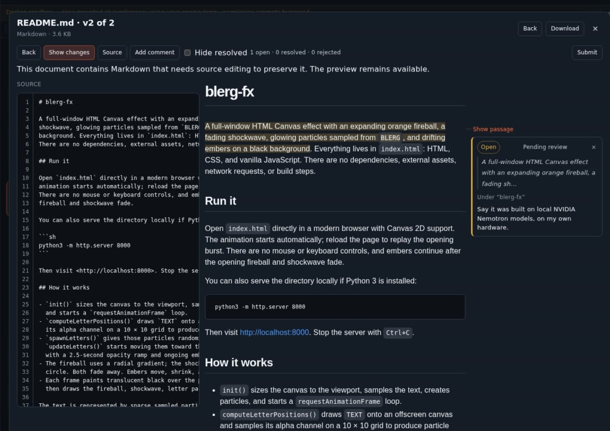

<p align="center">
  
</p>

<p align="center">
  <b>One place to run all your coding agents</b>: Claude Code, Codex, and Hermes on a local model.<br>
  On your laptop, in sandboxes or on your Kubernetes cluster, under your own login and budget.
</p>

<p align="center">
  <a href="https://github.com/blerglab/blerg-ai/releases"></a>
  <a href="https://github.com/blerglab/blerg-ai/actions/workflows/ci.yml"></a>
  <a href="LICENSE"></a>
</p>

<table align="center"><tr>
<td align="center" width="50%"><a href="https://www.youtube.com/watch?v=NKZk2pgB_LA"></a><br><b>MORE POWER</b> (1:13)<br>NVIDIA Nemotron on a DGX Spark commands Claude and Codex</td>
<td align="center" width="50%"><a href="https://www.youtube.com/watch?v=kahpuujFju0"></a><br><b>An AI agent made this</b> (2:09)<br>A tour of Blerg, recorded and voiced by AI</td>
</tr></table>

Blerg is a self-hosted, open-source home for coding agents. It starts the agent CLIs you already
use, streams what each one does into a chat you can talk back to, and puts every session, and every
session those sessions start, in one live view.

- **Agents share the load.** A Claude session can hand a task to Codex or to a model on your own
  GPU, with your approval, check whose usage limit has room, and collect the result.
- **See every agent at once.** A live panel shows sub-agents, child sessions, background work,
  progress and token spend; the sidebar nests the sessions an agent started under it.
- **Plan on a board.** Agents draft cards, you curate them, and a card starts a session that pins
  its ticket and keeps a checklist.
- **Review anything an agent makes:** code diffs line by line, documents, PDFs and images, with
  requests the agent answers one by one. Agents can answer with diagrams and charts, too.
- **Your machines, your rules.** Sessions run sandboxed by default, on your laptop or in a
  throwaway pod on your cluster. One login covers everything, and each person's credentials stay
  their own.

<p align="center">
  
  <br><sub>A real session: NVIDIA Nemotron 3.5 Super VL, running locally, started Claude and Codex as its crew.</sub>
</p>

<table><tr>
<td width="33%"><br><sub><b>Agents start agents, with your approval.</b></sub></td>
<td width="33%"><br><sub><b>Code review in place.</b></sub></td>
<td width="33%"><br><sub><b>Review anything.</b></sub></td>
</tr></table>

It is for one developer who wants agents working on real repositories without handing a laptop
over to them, and for a team that wants the same thing on a cluster. Blerg is built with Blerg:
most of it was written by agents running inside it.

> **Are you an AI agent?** Read [`AGENTS.md`](AGENTS.md). It tells you how to find, drive and
> install a Blerg, and how to work in this repository.

## Quickstart

Needs Docker, and Claude Code or Codex installed and logged in (Linux, macOS, or Windows with
WSL2). The first run builds the sandbox image, which takes a few minutes.

```
git clone https://github.com/blerglab/blerg-ai.git blerg && cd blerg/install/desktop
./blerg-up.sh
```

The script builds and starts everything, then opens `http://localhost:8081/setup`: choose your
username and password there to create your (admin) account, and you are signed in. Then open
**Runner** (`http://localhost:8083`) → **+ New**, pick a repository and launch. The rest of the first-day details, day-to-day commands and uninstall are in
[`install/desktop/README.md`](install/desktop/README.md). For a team, use the
[Kubernetes install](install/k8s/README.md).

## What a session looks like

```
you    › Add a --dry-run flag to scripts/deploy.sh and document it.
agent  › Read  scripts/deploy.sh
         Read  docs/deploy.md
         Edit  scripts/deploy.sh
         Edit  docs/deploy.md
         $ bash scripts/deploy_test.sh
agent  › Done: --dry-run prints the plan and exits 0, and all 7 deploy tests pass.
         I published the diff as deploy-dry-run.diff.
you    › Also refuse --dry-run together with --force.
```

Everything in that exchange happened inside a sandbox: the agent saw the repository and its own
login, and nothing else of the machine. The messages, files and tool calls are stored, so a
session can be reopened later and a cluster session resumed, and a session the board started can
attach its results to its card.

## What you can do

- **Sessions on the agent CLIs you already use** (Blerg calls them engines): Claude Code, Codex or
  Hermes, in a local sandbox, a cluster pod, or (opt-in) on the bare host; OpenClaw on the bare
  host only. [Runtimes](docs/architecture.md#runtimes)
- **Interactive or unattended.** Every agent session you or a tool start is told which. Interactive: the agent talks a plan
  over and asks before big decisions. Unattended: it makes the call, notes its assumptions,
  carries the work to the end and finishes with a summary. [`docs/talking-to-an-agent.md`](docs/talking-to-an-agent.md#interactive-and-unattended)
- **Talk to a running agent:** send messages mid-turn, interrupt, pause a cluster session, and
  review a published file passage by passage. A panel beside the chat shows what needs you and
  what is running (questions, subagents, background tasks, MCP servers), the ticket the agent
  pinned and its checklist or plan (Claude Code and Codex), a History of the pieces of work the
  agent marked with the files and commits each one produced, and the session's files and
  capabilities (skills, plugins, MCP servers). The first message waits briefly for MCP servers to
  connect, and you can send it at once. A session you follow tells you when it needs you,
  and once when all of its work is done. An agent session on your machine's host that a daemon
  restart cut off carries on by itself unless it was waiting for you, and one stopped by a usage
  limit can resume when the limit resets.
  [`docs/talking-to-an-agent.md`](docs/talking-to-an-agent.md)
- **Sessions that run other sessions.** An agent can start another agent session on any engine
  (say, Claude handing a task to Codex), then message it, send it files, watch it and collect
  its result, with no token to mint or paste. Each start asks you first: allow once, for this
  session, or always for an engine in your desktop sandbox. The sessions it started show in its
  panel like subagents, with their status and token spend, and nest under it in the sidebar. It
  can also check how much of each provider's usage limit is left and hand work to the engine
  with room. [`docs/talking-to-an-agent.md`](docs/talking-to-an-agent.md#when-the-agent-starts-other-sessions)
- **A board agents write to.** Cards are drafted by agents and curated by people; an admission
  step rejects duplicates and vague cards; a card can start a session. [`board/README.md`](board/README.md)
- **Files in and out:** attach files to a message, have the agent publish results (including a
  diff of its changes, shown in a diff viewer you can review line by line), preview HTML live,
  review and mark up markdown, PDFs and images from the chat, and see Mermaid diagrams and
  Vega-Lite charts drawn in place. [`docs/artifacts.md`](docs/artifacts.md)
- **Code you can read:** code blocks are highlighted (ten color themes, yours to pick), long ones
  fold into a viewer, files get inline previews, and a file the agent names opens from the
  session's folder. Copy and paste keep their structure: a copy button on every message, copied
  selections and pasted web text as Markdown. [`docs/talking-to-an-agent.md`](docs/talking-to-an-agent.md#copying-and-pasting)
- **MCP connections:** give a session tools from a remote MCP server (static token or OAuth)
  through a gateway that never shows the agent your credential. [`docs/mcp-connections.md`](docs/mcp-connections.md)
- **Crons:** scheduled, unattended runs with only the tools you chose. [`docs/crons.md`](docs/crons.md)
- **Proposals:** a write tool from an MCP connection can be set to queue each call for your
  approval instead of running it. [`docs/proposals.md`](docs/proposals.md)
- **Plugins** loaded into every Claude or Codex agent session you start, on a cluster or your desktop.
  [`core/docs/CONFIG.md`](core/docs/CONFIG.md#always-on-plugins)
- **Telemetry:** startup times, session durations, tokens and estimated cost, as a page, per
  session and as Prometheus metrics; the sidebar shows how much of your Claude and Codex usage
  limits is used. [`docs/telemetry.md`](docs/telemetry.md),
  [usage limits](runner/README.md#usage-limits)
- **Your own session image**, with the tools your projects need. [`docs/sandbox-image.md`](docs/sandbox-image.md)
- **Build your own app on it.** `@blerglab/chat` is the chat surface as a library: transcript,
  streaming, tool calls, files and a theme, over a pluggable transport, with a Go proxy so the
  runner's token never leaves your server. The runner and the board render it; your app can too.
  [`packages/chat/README.md`](packages/chat/README.md)

## How it compares

- **Claude Code or Codex alone on your laptop** is a terminal, one session at a time, running as
  you. Blerg keeps those exact tools and logins but adds the sandbox, the chat you can leave and
  come back to, several sessions at once, the board, and a cluster when one machine is not enough.
- **Hosted agent platforms** run your code on someone else's machines with their login. Blerg
  runs on yours, with your own subscription or API key; the only outside party that sees your
  code is the model provider you already use.
- **[Coder](https://github.com/coder/coder)** provisions whole development environments, for
  people and for agents, and manages them as infrastructure. Blerg is smaller and session-first:
  one chat per agent run, plus the board the runs come from.
- **[OpenHands](https://github.com/All-Hands-AI/OpenHands)** ships its own agent and can also
  drive Claude Code or Codex. Blerg ships no agent of its own, and adds the per-person credential
  vault, the sandboxes and the board.

## Safety in short

Agents run code, as somebody. A sandboxed session sees the repository and its engine login and
nothing else; the sandbox is not a credential vault, and a hostile repository or message can still
misuse the tools you allowed. Credentials are per person and encrypted; plugins, board automation
tokens and MCP connections all act with a person's credentials, so connect only what you would
hand to everyone who can write to that board. The desktop stack listens on `127.0.0.1` unless you
put TLS and authentication in front of it, and Docker group membership is root-equivalent. The
full model, and how to report a problem, is in [`SECURITY.md`](SECURITY.md).

## Documentation

| Install and operate | Use | Reference |
|---|---|---|
| [Desktop install](install/desktop/README.md) | [Talking to a running agent](docs/talking-to-an-agent.md) | [Architecture](docs/architecture.md) |
| [Kubernetes install](install/k8s/README.md) | [Files and attachments](docs/artifacts.md) | [Runner API and MCP server](runner/README.md) |
| [The workstation daemon](install/desktop/DAEMON.md) | [MCP connections](docs/mcp-connections.md) | [Core configuration](core/docs/CONFIG.md) |
| [Cluster sessions](install/k8s/CLUSTER-RUNTIME.md) | [Crons](docs/crons.md) | [Board configuration](board/docs/CONFIG.md) |
| [Your own session image](docs/sandbox-image.md) | [Proposals](docs/proposals.md) | [The chat package](packages/chat/README.md) |
| [Backup and restore](docs/backup-and-restore.md) | [Telemetry](docs/telemetry.md) | [Design notes](docs/design/) |
| [Install with an AI agent](install/k8s/AGENT-INSTALL.md) | | [Runner configuration](runner/README.md#configuration-env) |
| | | [Changelog](CHANGELOG.md) |

## Project status

Blerg is pre-1.0: breaking changes may land in any minor release and are called out in
[`CHANGELOG.md`](CHANGELOG.md). Only the current `main` receives security fixes.

## Contributing

[`CONTRIBUTING.md`](CONTRIBUTING.md) covers setup, tests, releases and what we look for in a
change; the [Code of Conduct](CODE_OF_CONDUCT.md) applies everywhere in the project.

Claude and Claude Code are trademarks of Anthropic; Codex and OpenAI of OpenAI; Hermes, OpenClaw
and every other name here belong to their owners. Blerg is independent and not affiliated with,
sponsored by or endorsed by any of them. Licensed under the [Apache License 2.0](LICENSE).
