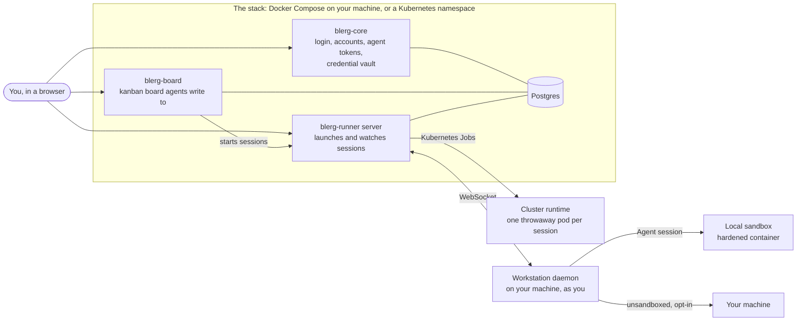

# Architecture

Get a session's recorded branch with `blerg-runner session result <id>` and use
its `branch` value wherever `<work-branch>` appears below. For a child, pass the
child's ID. Branch names stay fixed after a rename; never derive them from IDs
or titles. Workspace results also report each member's branch.

Blerg is three services, a database, and the places where sessions actually run.

## Components

- **`blerg-core`** is the control plane. It issues the login every other component accepts, holds
  each person's engine and git credentials encrypted, mints agent tokens, and serves the `/agents`
  manifest that describes the whole install. Configuration: [`core/docs/CONFIG.md`](../core/docs/CONFIG.md).
- **`blerg-board`** is a kanban board built for agents to write cards and people to curate them.
  An admission step turns away duplicates and vague cards; a card can start a session through the
  runner. [`board/README.md`](../board/README.md), [`board/docs/CONFIG.md`](../board/docs/CONFIG.md).
- **`blerg-runner`** launches and supervises agent sessions and streams their work back as
  structured events. Its web UI has the launch sheet and the chat; its REST contract and MCP server
  are what agents and tools use. [`runner/README.md`](../runner/README.md).
- **The workstation daemon** runs on your machine, as you, and does the actual launching for the
  desktop install. It cannot be containerised because it drives your own `claude` or `codex` login
  and engine settings. [`install/desktop/DAEMON.md`](../install/desktop/DAEMON.md).
- **Postgres** holds the records: one database per service (`blerg_core`, `blerg_board`,
  `blerg_runner`) in one instance, on both installs. Files a session publishes or you upload sit
  on the runner's data volume, and the credential encryption key is in `.env` or the
  `blerg-secrets` Secret. [`docs/backup-and-restore.md`](backup-and-restore.md) lists all of it.

The three services share one login: core issues it, and the board and runner verify it. The
board and runner never see a password. On a cold load, runner first tries the existing hidden-frame
renewal and connects its WebSocket immediately when the token arrives. A failed renewal falls back
to core's `/auth/refresh`, at most once per page load (and three times in two minutes); when it can't get one, the board
and runner say "Couldn't sign you in · Retry" instead of showing an empty page, and keep trying by
themselves through the hidden-frame renewal (never a full-page redirect): when the network comes
back, when the tab is shown, and after 5, 15, 30 and 60 seconds, then every two minutes while the tab
is visible. A token takes the banner down with no reload. If core answers that the sign-in itself
has ended (no refresh cookie, or its session expired or was revoked), the banner reads "Your sign-in
has ended · Sign in" and stops trying; a core that does not answer is retried. Agents authenticate with tokens core mints, scoped by a
preset, and a session gets a token of its own, valid for that session only and revoked when it
ends.

Cluster engines receive the session messaging token through the pod's synthesized
spawn message, alongside the selected board gateway grant. The runtime credential
stays with the supervisor. Generated workflow skills live in a separate
`/tmp/blerg-session-skills-<home hash>` tree beneath sticky `/tmp`:
supervisor-owned directories are `0750`
and files are `0640`, readable by the agent group without write access. Credential
and controller-private directories retain their existing private permissions.
A live cluster's pending checkout recovery location is normal startup state and
does not generate a failure alert. Explicit delivery errors, failed runtimes,
and ended runtimes with pending work retain normal failure reporting.

## Runtimes

Every session runs in exactly one place, chosen on the launch sheet:

| Runtime | Where | Default on | Sees |
|---|---|---|---|
| **Local sandbox** | A hardened container on the daemon's host: capabilities dropped, memory and processes limited | the desktop install | a clone of its own of the repository at `/workspace` (never the checkout or its `.git`; commits come back on `<work-branch>`), and the engine logins mounted in so the engine can work |
| **Cluster** | A throwaway Kubernetes Job in its own namespace, with the credentials of the person who launched it | the Kubernetes install | the repository, and the credentials core fetched for that person |
| **This machine** | The daemon's host, unsandboxed, as the person running the daemon | never; needs an acknowledgement | everything that person can see |

Host children of workspace sessions get a separate Git worktree for each selected member,
starting at that member's current parent HEAD on `<work-branch>`. Worktrees live under
`host-children/<child-id>` in the daemon's private state directory; a signed per-member
allocation journal supports restart cleanup. Commits are immediately available in the shared
repository. Discard removes only clean worktrees still on their expected branch and keeps all
branches. Worktrees with tracked changes, untracked non-ignored files, changed branches,
detached HEADs or unproven allocations are retained and reported for recovery. Ignored build
output does not block cleanup. A member without a Git commit
is refused, as is a checkout with configured Git filters; a child never falls back to its
parent's checkout. Top-level host sessions continue to use the selected source directories.

The runner's `runtime_targets` table names the existing cluster (`id: cluster`,
`kind: cluster`, `name: Cluster`, `config: {}`, `is_default: true`). Migration 122
seeds it and backfills references in one transaction, including fresh installs.
The empty config is reserved target configuration; deployment environment and
JobManager settings remain the source of cluster configuration and credentials.
No credential is copied into the target record. This release exposes one target;
additional cluster executors are deferred to 0.7.0.

Cluster sessions, explicitly cluster-pinned crons, retained cluster storage,
owner shells and session storage/file audit records carry `runtime_target_id`.
The board database stores the runner's external target ID on board defaults and
runner sessions (board migration 039); it does not own a second target catalog.
Desktop identity and placement continue to use `daemon_id`. Legacy writers that
omit the ID receive the default atomically through compatibility triggers.
Launch discovery, session metadata, status/results, cron APIs and shell metadata
carry the ID; the launch sheet shows the stored target name. Start and discovery
requests can carry `runtime_target_id`; omitted means the default cluster target,
and unknown IDs refuse before launch side effects. Workspace manifest digests and
daemon messages remain compatible: the persisted session supplies the target
without changing the signed workspace or shell-grant wire formats.

Command/Git policy storage from BLG-253 is not present at this branch base. When
introduced, cluster policy keys must include this target ID, as existing cluster
shell and session storage audit records already do.

How cluster sessions are built, scheduled and cleaned up: [`install/k8s/CLUSTER-RUNTIME.md`](../install/k8s/CLUSTER-RUNTIME.md).
How the local sandbox is hardened and what it mounts: [`install/desktop/DAEMON.md`](../install/desktop/DAEMON.md).
Changing the image sessions run in: [`sandbox-image.md`](sandbox-image.md).

## Engine adapters and catalogs

Use the [feature inventory](features.md) to check application coverage and
[Adding an engine](adding-an-engine.md) for adapter work, verification, and current abstraction
limits. The [parity review](design/engine-parity-review.md) separates implemented extension
points from proposed consolidation.

Daemon `EngineSpec` entries own native process setup, credentials, model discovery and driver
selection. Shared launch and recovery paths reject unknown engine names before preparing a
workspace or choosing a driver. Native protocol events are translated into the shared agent
contract; usage counters use disjoint input, cache-read and cache-write buckets.

Cluster native history uses a separate engine layout registry: only the conversation files,
SQLite state where needed, and a bounded identity/receipt journal are mounted from an
account/session/engine-bound PVC. Credentials and current grants are prepared fresh. Database
bindings include the immutable Kubernetes claim UID; expected missing state fails recovery rather
than becoming a new conversation. A distributed writer fence waits for old Jobs and pods before
replacement. Paused native-backed sessions do not expire; true endings and permanent deletion
start configurable storage retention, with deletion tombstones preserving cleanup tracking.
Legacy sessions without native history use archive recovery, which does not restore native identity.

Workstation model catalogs come from that daemon's engine probes. Cluster model discovery has a
separate provider registry in `runner/internal/server/clustermodelproviders.go`: a provider owns
native acquisition and safe error messages, while shared code handles account authorization,
sanitization, persistence and asynchronous refresh. Cache identity includes account, engine and
agent image. Startup loads persisted snapshots; requests return immediately with a snapshot or
pending status while refresh runs in the background. Public catalogs can serve Cluster engines
without a native provider; workstation catalogs cannot. The chat, launch and cron pickers use the
same runtime target and bounded requests, retaining manual entry and retry during discovery.

Adding an engine requires its model rules and daemon adapter, plus a Cluster provider when its
catalog needs native account access. It does not require another model endpoint or picker branch.
Opaque Cluster credential imports remain snapshots. Codex snapshots carry access only and need a dedicated managed login for renewal. An
opt-in managed connection uses a separately registered Core credential adapter and a dedicated
browser device login. Core alone retains encrypted refresh authority, serializes rotation and
fences replacements by generation. Pods obtain short-lived access through their current runtime
token, which the agent's environment does not carry; the account and live authorizing principal come from the private server launch record.
Settings presents managed Codex connections separately from pasted credential snapshots. Before connecting, enable device code sign-in in ChatGPT → Settings → Security. The launch sheet links directly to Managed connections and blocks cluster Codex launches when credentials are missing or require reconnection. The workstation login remains independent. Catalog caching never authorizes inference or chooses
another payer after a credential failure. See [credential lifecycle](design/engine-credential-lifecycle.md).

## Session kinds

- An **Agent** session drives the engine non-interactively: the engine's permission prompts are
  bypassed and its work streams into the chat as structured events. It is `interactive` when a
  person is reading along and `unattended` when nobody is, and the engine is told which.
- A **cron** is an unattended agent session on a schedule, with only the tools you chose.

What a session can reach, and how messages, files and MCP tools get in and out, is described from
the person's side in [`talking-to-an-agent.md`](talking-to-an-agent.md),
[`artifacts.md`](artifacts.md) and [`mcp-connections.md`](mcp-connections.md), and from the
agent's side in [`AGENTS.md`](../AGENTS.md).

## Repository layout

| Path | What |
|---|---|
| `contracts/` | Go packages shared by the services: identity, secrets, the agents manifest, network guards |
| `core/`, `board/`, `runner/` | One Go module and one web app each |
| `packages/chat/` | `@blerglab/chat`, the chat surface as a package, used by the runner and the board and installable by other apps |
| `install/desktop/`, `install/k8s/` | The two installers, with their own documentation |
| `docs/` | User documentation and, under `design/`, the notes behind larger decisions |
| `scripts/` | Checks CI runs: links, the privacy scrub, the release tooling |

## Workspace integration

Workspace selection and physical runtime authority are separate. P1 persists an
immutable authorized member manifest; P0b allocates a runtime generation and pins
the prepared public root. P2 and P3 own preparation, settlement, retention and
writer cleanup. P4 reads only through that runtime binding. P5 independently
checks live human identity, policy, grants and containment; selection grants no
shell permission.

Empty host folders carry an opaque desktop and configured-root identity in the
manifest root metadata. Recovery verifies it independently of member identities;
older empty-folder manifests without that identity fail closed.

The desktop control adapter uses the enrolled outbound socket and persisted owner
and connection fences. Migration 083 journals generation tokens and exact final
outcomes. Results, terminal state and receipt commit atomically; reconnect can
reconcile an identical completion even after ordinary live-runtime authority has
ended. A definitive authenticated authority refusal ends local cleanup retries
and removes that journal from heartbeat claims, including after restart. Unknown or reassigned
sessions, confirmed host manifest replacements, and replaced recovery bindings
are terminal too. Transient
recovery failures back off exponentially from one second to one minute per
incarnation; an explicit stop sweeps only its own journal. The
journal and remaining work stay on disk; refusal never substitutes for a
completion receipt or permits deleting retained storage. Failed sandbox workspace
preparations keep their existing incomplete-preparation journal and never claim
heartbeat liveness, including before cleanup and after daemon restart. In-flight
preparations are reported separately as queued spawns. The launch remains failed with its cause
instead of being revived as running and showing a ready card. Quota allocation
and preparation failures log safe, rate-limited diagnostic causes. Their private
allocation journals remain available for authenticated cleanup; a definitive
cleanup refusal retains the allocation and stops retrying. Other transient failures
remain pending. Files and shell bytes use bounded separate scheduling lanes and never
become agent transcript events.

Workspace and shell policy enables verified Linux/WSL hosts, local sandboxes and
cluster pods. Native macOS host remains disabled (#181). Protected storage,
containment and exact capability negotiation remain mandatory. The [integration
status](workspace-integration.md) records runtime support and remaining acceptance
work. Unavailable capabilities return explicit refusals.

## Failure logs

Core, Board and Runner record failed HTTP responses through the shared
`contracts/failurelog` middleware. Look in the corresponding service's stderr
(container logs on desktop or pod logs on Kubernetes). Each structured `failure`
entry includes the component, registered route pattern (or `unmatched`), status,
duration in milliseconds, hexadecimal error ID when supplied, and recognized
opaque session/board IDs. Expected 401, 404 and 429 responses use WARN; other
failures, including failed reads and 5xx, use ERROR. A route/status pair emits at
most once per minute; the next emitted entry includes the intervening suppressed
count. The rate limiter has a bounded overflow bucket.

Workstation filesystem, Git, branch/commit and recovery diagnostics live in the
**daemon's stderr**, not the Runner container. Search `component=daemon` in the
structured JSON and use `stage` plus `cause` (permission, missing file, deadline,
process exit code or error type). Runner-to-Board and Board-to-Core failures
include `upstream` and HTTP `status` (zero for a transport failure). These records
exclude URLs, query strings, headers, request/response content, command output
and workspace paths. Browser HTTP refresh/write failures are visible in the
receiving service's logs; there is currently no general browser error reporting
endpoint for network failures that never reach a service.

From the desktop install directory, use `docker compose logs blerg-core`,
`docker compose logs blerg-board`, or `docker compose logs blerg-runner`.
On Kubernetes, use `kubectl logs -n <namespace> deployment/blerg-core`
(and likewise `blerg-board` or `blerg-runner`). On Linux/WSL the daemon is a
user service: `journalctl --user -u blerg-runner-daemon -f`. On macOS, use
`tail -f ~/Library/Logs/blerg/blerg-runner-daemon.log`.

The workstation daemon's input journal retains at most 256 receipts. Before
accepting a new input it prunes acknowledged, settled receipts older than seven
days, then evicts the oldest acknowledged receipt if the count limit requires it.
Pending and unacknowledged receipts remain protected against duplicate execution.
For newly written receipts, server-owned plan context is excluded from the caller
identity hash; legacy receipts retain their original strict hash checks.
Acceptance failures record a safe typed cause and session identifier, with repeated
causes rate limited and counted. The retryable transcript error includes the same
cause. Storage errors include a typed filesystem cause, never a path or message text.
These daemon changes require reinstalling the workstation daemon.

Blackboard slice reads resolve unlinked plan cards with `blerg_card_search`'s
`numbers` filter, up to 100 numbers per board per call, including archived cards.
Missing numbers become deleted/moved-out rows; a failed search never becomes a
missing-card observation. Results retain the plan's order, and columns are read
once per board. Deploy the board's numbers-filter support with or before runner.

A slice shares one read-only delegated credential per proof, session and board,
revoking it when the read finishes (including errors). Current session permissions
are still checked on every adapter call. The gateway caches successful card and
column replies for two seconds, bounded to 128 replies of at most 128 KiB each,
separately by proof, session, board, tool and arguments. A new read must exchange a
fresh credential before consulting that cache, so cached replies cannot bypass
live proof validation. Card versions travel with the cached snapshot; edits can
appear up to two seconds later. Question-derived stages are recomputed outside
this cache. The browser shows the plan structure before waiting for card details.

Main also checks board structure at turn end and after successful session board
mutations. Exactly one terminal Done column is required; discrepancies stay in
Main's `plan_drift` queue with a column command. A single version tag that differs
from a milestone's version name makes a member's observed stage `moved_out`, with
the old and new tags as evidence. Restoring the tag reverses the observation;
approved scope is preserved. Cards tagged for an unlinked milestone are offered
as unplanned. Conflicting version tags require Main's decision. When both release
records exist, a release-ID correction first comments the evidence, rereads the
card, then updates with its current version and current session write authority.
Direct edits in the Board app are checked at the next Main turn; runner does not
subscribe to a cross-service Board event feed.

Event-triggered checks are coalesced per workspace with a three-second debounce,
with at most one pending or running event scan. They run after the tool reply;
turn end remains the guaranteed check. Unplanned cards are summarized once per
milestone, with their count, first five card keys and a review command.

A human card comment starting `Done reason:` with a nonempty reason is an
explicit completion exception. Agent comments do not qualify: the Board trail
does not yet prove which agent is Main. Existing pre-cutover completion
protections remain. To-test cards lacking a deployed active main merge are
summarized for Main, preserving their tags. Absence warnings require a proven tag
addition at or after this workspace's first valid single-SHA `Deployed:` mark.
Board's optional `to_test_added_at` on card-with-trail comes from tag-change
history across the full audit record, including additions outside the bounded
trail. An older Board or an unknown historical tag-addition time produces no
absence warning. Deploy Board and Runner together for this evidence field.

A reconciliation run shares its paged search and column reads across structure
and code checks, with live authorization still checked before every use. Search
summaries batch-project tag-addition time, the human completion-reason flag and
the latest explicit move time. Healthy cards need no individual trail read.
Each phase examines at most ten detail candidates per run and rotates its offset
on subsequent runs; writes still reread and version-guard the card. The cache is
run-local and invalidated by writes. A healthy 600-card, single-board workspace
uses six search pages, one column list and one release list: eight Board calls.

Stalled-card checks use a four-hour commit window, live linked workers and open
Main checklist items naming the card. Starting, running and waiting workers
count as live. Idle workers count only when their latest `turn_done` is within
that window, or they have an open question addressed to Main. Ended, archived
or discarded workers do not count. Comments and tag changes never reset the
commit window. With several boards, ambiguous checklist card numbers do not
suppress a stalled-card warning.

The daemon separately returns bounded subject/date activity from local branches,
including worker session branches visible in that repository. This activity is
never passed to merge/deploy proof. Missing activity support on an older daemon
suppresses absence-based stalled warnings and asks Main to update it. Activity
reads have a validated cutoff, 1,000-entry and frame limits, and typed failure
causes. Reinstall the workstation daemon with Runner for invariant 2.

### Daemon connection liveness

The runner sends WebSocket control pings every 20 seconds, outside the daemon
application queues. Pongs renew a 90-second read lease; application request
expiration does not revoke that lease. Each started data frame in either direction has an
independent socket write bound (at most one second), including frames admitted
under a nearly expired server authority fence. Request cancellation drops
queued frames and stops transfers between chunks, allowing an active frame to
finish without poisoning the shared connection. Socket close diagnostics retain
safe causes and numeric close codes, excluding peer-provided close text. Local
close sites emit a `close_` stage on the initiating component, including handshake
refusals, ownership changes, pump shutdown and daemon context cancellation.
Ingress allows one-hour read/send idle timeouts; upgraded WebSocket frames use
the tunnel, not the HTTP body-size cap.

Personal-daemon heartbeat issuer validation runs before acquiring the desktop
advisory transaction. Database authority timeouts are logged as
`authority_timeout`, separately from socket write/read timeouts. Admission gets
one fresh-fence retry; completed handlers and writes are never replayed. A
definitive ownership or token refusal closes the connection immediately.

Explorer listings visit at most 10,000 entries and return at most 500 entries per
page, checking cancellation before each child open. Turn-end workspace sync has
the existing 80-second sync budget; its authority checks retry transport failures
for at most 15 seconds per check, including across reconnects. Authenticated definitive
refusals remain final, and reconnection must reauthorize the same incarnation.

Host child worktrees journal their allocation before Git checkout. A synchronous
preparation failure removes the attempt's unchanged worktrees, atomically created
branches and empty namespace, so a retry can allocate again. Changed or unproven
content is retained for recovery; interrupted preparations still require the
journal's conservative recovery checks. Host child Git failures capture at most
4 KiB of stderr and report fixed, recognized explanations in logs and worker
errors. Unrecognized diagnostics are redacted, including paths, refs and arbitrary
hook output; no raw stderr is recorded.
