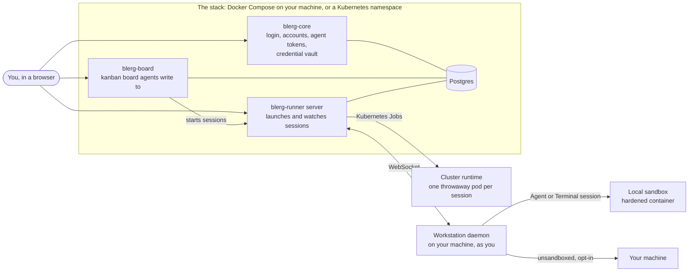

# Architecture

Blerg is three services, a database, and the places where sessions actually run.

## Components

- **`blerg-core`** is the control plane. It issues the login every other component accepts, holds
  each person's engine and git credentials encrypted, mints agent tokens, and serves the `/agents`
  manifest that describes the whole install. Configuration: [`core/docs/CONFIG.md`](../core/docs/CONFIG.md).
- **`blerg-board`** is a kanban board built for agents to write cards and people to curate them.
  An admission step turns away duplicates and vague cards; a card can start a session through the
  runner. [`board/README.md`](../board/README.md), [`board/docs/CONFIG.md`](../board/docs/CONFIG.md).
- **`blerg-runner`** launches and supervises agent sessions and streams their work back as
  structured events. Its web UI has the launch sheet and the chat; its REST contract and MCP server
  are what agents and tools use. [`runner/README.md`](../runner/README.md).
- **The workstation daemon** runs on your machine, as you, and does the actual launching for the
  desktop install. It cannot be containerised because it drives your own `claude` or `codex` login
  and `tmux`. [`install/desktop/DAEMON.md`](../install/desktop/DAEMON.md).
- **Postgres** holds the records: one database per service (`blerg_core`, `blerg_board`,
  `blerg_runner`) in one instance, on both installs. Files a session publishes or you upload sit
  on the runner's data volume, and the credential encryption key is in `.env` or the
  `blerg-secrets` Secret. [`docs/backup-and-restore.md`](backup-and-restore.md) lists all of it.

The three services share one login: core issues it, and the board and runner verify it. The
board and runner never see a password. A page without a token goes to core's `/auth/refresh` for
one at most once per page load (and three times in two minutes); when it can't get one, the board
and runner say "Couldn't sign you in · Retry" instead of showing an empty page, and keep trying by
themselves through the hidden-frame renewal (never a full-page redirect): when the network comes
back, when the tab is shown, and after 5, 15, 30 and 60 seconds, then every two minutes while the tab
is visible. A token takes the banner down with no reload. If core answers that the sign-in itself
has ended (no refresh cookie, or its session expired or was revoked), the banner reads "Your sign-in
has ended · Sign in" and stops trying; a core that does not answer is retried. Agents authenticate with tokens core mints, scoped by a
preset, and a session gets a token of its own, valid for that session only and revoked when it
ends.

## Runtimes

Every session runs in exactly one place, chosen on the launch sheet:

| Runtime | Where | Default on | Sees |
|---|---|---|---|
| **Local sandbox** | A hardened container on the daemon's host: capabilities dropped, memory and processes limited | the desktop install | a clone of its own of the repository at `/workspace` (never the checkout or its `.git`; commits come back on `wip/<session-id>`), and the engine logins mounted in so the engine can work |
| **Cluster** | A throwaway Kubernetes Job in its own namespace, with the credentials of the person who launched it | the Kubernetes install | the repository, and the credentials core fetched for that person |
| **This machine** | The daemon's host, unsandboxed, as the person running the daemon | never; needs an acknowledgement | everything that person can see |

How cluster sessions are built, scheduled and cleaned up: [`install/k8s/CLUSTER-RUNTIME.md`](../install/k8s/CLUSTER-RUNTIME.md).
How the local sandbox is hardened and what it mounts: [`install/desktop/DAEMON.md`](../install/desktop/DAEMON.md).
Changing the image sessions run in: [`sandbox-image.md`](sandbox-image.md).

## Engine adapters and catalogs

Use the [feature inventory](features.md) to check application coverage and
[Adding an engine](adding-an-engine.md) for adapter work, verification, and current abstraction
limits. The [parity review](design/engine-parity-review.md) separates implemented extension
points from proposed consolidation.

Daemon `EngineSpec` entries own native process setup, credentials, model discovery and driver
selection. Shared launch and recovery paths reject unknown engine names before preparing a
workspace or choosing a driver. Native protocol events are translated into the shared agent
contract; usage counters use disjoint input, cache-read and cache-write buckets.

Cluster native history uses a separate engine layout registry: only the conversation files,
SQLite state where needed, and a bounded identity/receipt journal are mounted from an
account/session/engine-bound PVC. Credentials and current grants are prepared fresh. Database
bindings include the immutable Kubernetes claim UID; expected missing state fails recovery rather
than becoming a new conversation. A distributed writer fence waits for old Jobs and pods before
replacement. Paused native-backed sessions do not expire; true endings and permanent deletion
start configurable storage retention, with deletion tombstones preserving cleanup tracking.
Legacy sessions without native history use archive recovery, which does not restore native identity.

Workstation model catalogs come from that daemon's engine probes. Cluster model discovery has a
separate provider registry in `runner/internal/server/clustermodelproviders.go`: a provider owns
native acquisition and safe error messages, while shared code handles account authorization,
sanitization, persistence and asynchronous refresh. Cache identity includes account, engine and
agent image. Startup loads persisted snapshots; requests return immediately with a snapshot or
pending status while refresh runs in the background. Public catalogs can serve Cluster engines
without a native provider; workstation catalogs cannot. The chat, launch and cron pickers use the
same runtime target and bounded requests, retaining manual entry and retry during discovery.

Adding an engine requires its model rules and daemon adapter, plus a Cluster provider when its
catalog needs native account access. It does not require another model endpoint or picker branch.
Opaque Cluster credential imports remain snapshots and require reimport when rejected. An
opt-in managed connection uses a separately registered Core credential adapter and a dedicated
browser device login. Core alone retains encrypted refresh authority, serializes rotation and
fences replacements by generation. Pods obtain short-lived access through their current runtime
token, which the agent's environment does not carry; the account and live authorizing principal come from the private server launch record.
The workstation login remains independent. Catalog caching never authorizes inference or chooses
another payer after a credential failure. See [credential lifecycle](design/engine-credential-lifecycle.md).

## Session kinds

- An **Agent** session drives the engine non-interactively: the engine's permission prompts are
  bypassed and its work streams into the chat as structured events. It is `interactive` when a
  person is reading along and `unattended` when nobody is, and the engine is told which.
- Existing **Terminal** sessions run in `tmux` with the engine's permission prompts on.
  New Terminal sessions are deprecated and refused in 0.4.5 when a person or an agent starts
  one; a board's Assist still starts one until it moves to an agent session in 0.5.0, when
  Terminal support will be removed. Existing sessions keep working until that removal.
- A **cron** is an unattended agent session on a schedule, with only the tools you chose.

What a session can reach, and how messages, files and MCP tools get in and out, is described from
the person's side in [`talking-to-an-agent.md`](talking-to-an-agent.md),
[`artifacts.md`](artifacts.md) and [`mcp-connections.md`](mcp-connections.md), and from the
agent's side in [`AGENTS.md`](../AGENTS.md).

## Repository layout

| Path | What |
|---|---|
| `contracts/` | Go packages shared by the services: identity, secrets, the agents manifest, network guards |
| `core/`, `board/`, `runner/` | One Go module and one web app each |
| `packages/chat/` | `@blerglab/chat`, the chat surface as a package, used by the runner and the board and installable by other apps |
| `install/desktop/`, `install/k8s/` | The two installers, with their own documentation |
| `docs/` | User documentation and, under `design/`, the notes behind larger decisions |
| `scripts/` | Checks CI runs: links, the privacy scrub, the release tooling |

## Workspace integration

Workspace selection and physical runtime authority are separate. P1 persists an
immutable authorized member manifest; P0b allocates a runtime generation and pins
the prepared public root. P2 and P3 own preparation, settlement, retention and
writer cleanup. P4 reads only through that runtime binding. P5 independently
checks live human identity, policy, grants and containment; selection grants no
shell permission.

The desktop control adapter uses the enrolled outbound socket and persisted owner
and connection fences. Migration 083 journals generation tokens and exact final
outcomes. Results, terminal state and receipt commit atomically; reconnect can
reconcile an identical completion even after ordinary live-runtime authority has
ended. Files and shell bytes use bounded separate scheduling lanes and never
become agent transcript events.

Workspace and shell capability gates remain false until their real lifecycle,
protected-storage, platform and independent security gates pass. The [integration
status](workspace-integration.md) lists the current missing bindings and acceptance
work. Unavailable capabilities return explicit refusals.
